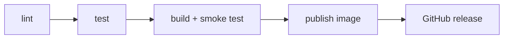

# Pipeline description

This page explains the whole path from a commit to a published release, stage by stage.
The workflow itself is `.github/workflows/pipeline.yml`.

## When it runs

- On every push or pull request to `main`: lint, test and build run. Nothing is published.
- On a tag that starts with `v` (for example `v1.0.0`): the same three stages run first,
  then `publish` and `release` run as well. If any early stage fails, the later ones are
  skipped, so a broken commit can never turn into a release.

## The stages

**lint** installs the dev requirements and runs `ruff check .`. It is the cheapest check, so it
goes first.

**test** runs the pytest suite. Each test points the app at a temporary data file, so tests
never touch real data.

**build** builds the Docker image, starts a container from it and calls the API: `/health`,
`/version`, then it adds an expense and reads the summary. Passing unit tests does not prove
that the image works, so this step actually runs the thing. If something fails, the container
logs are printed at the end of the job.

**publish** only runs for version tags. It logs in to GitHub Container Registry with the
built-in `GITHUB_TOKEN` (no extra secrets to manage), builds the image again with the version
number baked in, and pushes it as `<version>` and `latest`.

**release** only runs after publish succeeds. It reads `CHANGELOG.md`, cuts out the section
for the tag being released and creates a GitHub release with that text as the notes. If the
changelog has no section for the version, it falls back to the notes GitHub generates from
the commits.

## How the version travels

The tag `v1.0.0` becomes `1.0.0`, which is passed to Docker as a build argument, stored in an
environment variable inside the image, and returned by the `/version` endpoint. After a
release I can pull the image, run it and ask it which version it is, so there is no doubt
about what is running.

## Permissions

The workflow starts with read-only access to the repository. Only `publish` gets
`packages: write` and only `release` gets `contents: write`, and only for those jobs.

## Screenshots of a successful run

Pipeline run for a release tag, all five stages green:

The GitHub release that the pipeline created, with the notes from the changelog:

The image as it shows up in GitHub Packages:

The published image running on my machine and answering `/version`:

## What I would add next

A real deploy target (a small VPS or a platform like Render) so that a release also updates
a running service, and a vulnerability scan of the image before it is published.
